# Codebase Diagnosis: Akosua's Pharmacy Stock & Dispensing Tracker

## 1. Executive Summary
The existing codebase is a single-file prototype that handles medication inventory, customer tracking, dispensing, and daily reporting for Akosua's pharmacy in Accra. Akosua does not trust this system because it permits catastrophic inventory failures—such as dispensing non-existent stock into negative values—while exposing internal state to arbitrary tampering, risking patient safety and financial integrity.

---

## 2. Ranked Defect Analysis (Ranked by Danger to Akosua's Business)

### Rank 1: Unguarded Public Stock Field and Negative Inventory
- **Code Location**: `PharmacyTracker.java`, Line 40 (`public int stock;`) & Lines 117, 129 (`m.stock = m.stock - qty;`)
- **Severity**: **Critical**
- **Root Cause**: The `stock` field has `public` visibility with zero validation before decrementing. `Pharmacy.dispense()` blindly subtracts the requested quantity from current stock without verifying whether `qty <= m.stock`.
- **Business Risk**: Patients can be promised or dispensed medications the pharmacy does not physically possess. In the baseline run, 100 units of Amoxicillin were dispensed when only 39 remained, resulting in `-61` units in stock. In a pharmacy, dispensing nonexistent drugs or dispensing without physical verification can lead to delayed patient care, emergency stock-outs for critical patients, and severe operational distress.

### Rank 2: Total Absence of Quantity Validation (Zero and Negative Quantities)
- **Code Location**: `PharmacyTracker.java`, Lines 110–135 (`dispense`), Lines 137–141 (`restock`)
- **Severity**: **Critical**
- **Root Cause**: Neither `dispense()` nor `restock()` checks if `qty > 0`.
- **Business Risk**: A negative dispense (`qty = -10`) decreases negative stock (effectively increasing stock by 10) while charging the customer a negative amount (the pharmacy "pays" the customer). Conversely, restocking with negative values decreases stock without supplier audits. This corrupts financial accounting, inventory counts, and daily reconciliations.

### Rank 3: Silent Failures and State Corruption on Unknown Categories
- **Code Location**: `PharmacyTracker.java`, Lines 112–135
- **Severity**: **High**
- **Root Cause**: An `if-else if` block only checks `"OTC"` and `"PRESCRIPTION"`. Any unrecognized category (e.g. `"CONTROLLED"`) falls through without executing dispensing or decrementing stock, yet the method proceeds unconditionally to execute lines 133–134:
  ```java
  c.history.add("Got " + qty + " x " + m.name);
  transactions.add(new Transaction(c.name, m.name, qty, total, "DISPENSE"));
  ```
- **Business Risk**: False transaction logs are committed stating the patient received the medication for `GHS 0.0`, and the patient's medical history falsely records receipt, even though no medication was dispensed and no stock was adjusted. This represents falsification of patient dispensing logs.

### Rank 4: God Class Antipattern in `Pharmacy`
- **Code Location**: `PharmacyTracker.java`, Lines 91–156
- **Severity**: **High**
- **Root Cause**: The `Pharmacy` class coordinates pricing calculations, customer discount evaluations, category-specific dispensing rules, stock modifications, transaction logging, customer history updates, and console reporting.
- **Business Risk**: Violates the Single Responsibility Principle. Any change in pricing policies, tax rules, or category requirements forces modifications to `Pharmacy`, risking regressions across all operations.

### Rank 5: Leaked Internal Mutable Collections
- **Code Location**: `PharmacyTracker.java`, Line 60 (`public List<String> history`), Line 93 (`public List<Medication> meds`), Line 94 (`public List<Customer> customers`), Lines 143–145 (`public List<Transaction> getTransactions() { return transactions; }`)
- **Severity**: **Medium**
- **Root Cause**: Internal collections are exposed either via `public` access or by returning direct references from getter methods.
- **Business Risk**: Any external code can call `pharmacy.getTransactions().clear()`, `pharmacy.meds.clear()`, or alter a patient's historical medical records directly, destroying auditability and integrity.

### Rank 6: Duplicated Discount and Deduction Logic
- **Code Location**: `PharmacyTracker.java`, Lines 113–117 and Lines 125–129
- **Severity**: **Medium**
- **Root Cause**: Identical discount logic (`if (c.kind.equals("REGISTERED")) total = total * 0.95;`) and stock decrement logic (`m.stock = m.stock - qty;`) are copy-pasted across both category branches.
- **Business Risk**: If Akosua updates the registered discount from 5% to 8%, a developer might update one branch and miss another, causing inconsistent pricing between OTC and prescription drugs.

### Rank 7: Primitive Obsession with String-Typed Categories and Kinds
- **Code Location**: `PharmacyTracker.java`, Line 41 (`public String category`), Line 57 (`public String kind`), Line 77 (`public String type`)
- **Severity**: **Medium**
- **Root Cause**: Domain classifications are represented as raw `String` literals rather than structured types or enums.
- **Business Risk**: Typos like `"Prescription"`, `"otc"`, or `"WALKIN"` fail silently at runtime or fail equality checks without compiler warnings, corrupting workflows.

### Rank 8: Prescription Check is Null-Only (Known Weakness Intentionally Preserved)
- **Code Location**: `PharmacyTracker.java`, Line 121 (`if (prescriber == null)`)
- **Severity**: **Medium**
- **Root Cause**: The legacy check only validates `prescriber == null`. It does not validate for empty or whitespace strings (`""` or `" "`).
- **Business Risk**: A blank prescriber can technically bypass the check in the legacy code.
- **Preservation Rationale**: This is a known weakness that I deliberately did NOT change in the production code because the lab brief requires strict behavior preservation. A one-line fix (`if (prescriber == null || prescriber.isBlank())`) would resolve it if strict validation were requested.

### Rank 9: Static ID Counters
- **Code Location**: `PharmacyTracker.java`, Lines 43, 61, 78 (`static int counter = 1;`)
- **Severity**: **Low**
- **Root Cause**: IDs are generated using static class counters that increment during constructor execution without thread synchronization or reset isolation.
- **Business Risk**: In automated unit testing or concurrent environments, static counters leak state between test cases, produce non-deterministic IDs, and are not thread-safe.

### Rank 10: Use of Binary Floating-Point (`double`) for Financial Values
- **Code Location**: `PharmacyTracker.java`, Line 39 (`public double price;`), Line 76 (`public double total;`), Line 111 (`double total = 0;`)
- **Severity**: **Low**
- **Root Cause**: Money is modeled using IEEE 754 binary floating-point (`double`).
- **Business Risk**: Binary floating-point cannot accurately represent all decimal fractions (e.g., `0.1 + 0.2 != 0.3`). Over time, rounding errors accumulate into discrepancies in daily revenue balances and tax calculations.

---

## 3. The Most Dangerous Problem

If I had to single out one flaw that threatens Akosua's Pharmacy above all others, it is the **unprotected, unvalidated stock decrement resulting in negative inventory**. A pharmacy is not an ordinary retail store; medication stock numbers directly dictate whether a sick patient receives an essential therapeutic treatment or is turned away. Permitting stock to hit `-61` while issuing a sales receipt of GHS 3000.0 means the system fabricates physical reality. Dispensing antibiotics that do not exist or dispensing without stock verification can lead to acute treatment delays, emergency stock-outs for critical patients, and invalid financial books.

---

## 4. What the Coming CONTROLLED-Substance Change Would Force Me to Touch in the Old Code

To introduce a `CONTROLLED` substance category (which requires logging a prescriber and strict audit limits) in the legacy code, I would be forced to modify:

1. **`PharmacyTracker.java` (Class `Pharmacy`, Method `dispense`)**:
   - Add another `else if (m.category.equals("CONTROLLED"))` branch at line 132.
   - Duplicate the 5% registered discount calculation yet again.
   - Duplicate the stock decrement calculation yet again.
   - Add prescriber validation logic for controlled substances.
   - Modify the printed output string specifically for controlled substances.
2. **`PharmacyTracker.java` (Class `Transaction`)**:
   - Add a `public String prescriber;` field to the `Transaction` class (lines 71–89).
   - Modify the constructor signature (`new Transaction(...)`) and update every single call site in `dispense` (line 134) and `restock` (line 139).
3. **`PharmacyTracker.java` (Class `Medication`)**:
   - The comment at Line 41 (`// "OTC" or "PRESCRIPTION"`) must be updated; no compiler enforcement prevents invalid strings.
4. **`PharmacyTracker.java` (Class `Pharmacy`, Method `printReport`)**:
   - Update report printing if controlled drugs require special flags.
5. **Existing Caller Code (`PharmacyTracker.main`)**:
   - Update any transaction reading code or dispense calls to handle the modified signatures.

This violates the **Open-Closed Principle**: adding one new category requires tearing open existing, working methods and classes, risking regressions across the entire codebase.

---

## 5. Planned Rebuilt Architecture
*(Note: this is the final version matching the rebuilt codebase; the original plan is in git history)*

I designed the rebuilt system around clear domain responsibilities, complete immutability where appropriate, guarded invariants, and polymorphism for medication categories.

```mermaid
classDiagram
    class StockLevel {
        -int units
        +StockLevel(int units)
        +int units()
        +StockLevel deduct(int qty)
        +StockLevel add(int qty)
        +boolean hasSufficient(int qty)
    }

    class Money {
        -double amount
        +Money(double amount)
        +double amount()
        +Money multiply(int qty)
        +Money applyDiscount(double multiplier)
        +String toString()
    }

    class Medication {
        <<abstract>>
        -int id
        -String name
        -Money price
        -StockLevel stock
        +Medication(int id, String name, Money price, StockLevel initialStock)
        +int id()
        +String name()
        +Money price()
        +int currentStock()
        +boolean hasSufficientStock(int qty)
        +void deductStock(int qty)
        +void addStock(int qty)
        +String categoryName()*
        +boolean requiresPrescriber()*
    }

    class OtcMedication {
        +categoryName() String
        +requiresPrescriber() boolean
    }

    class PrescriptionMedication {
        +categoryName() String
        +requiresPrescriber() boolean
    }

    class ControlledMedication {
        <<Future / Test-Scope>>
        +categoryName() String
        +requiresPrescriber() boolean
    }

    Medication <|-- OtcMedication
    Medication <|-- PrescriptionMedication
    Medication <|.. ControlledMedication : Future Extension
    Medication *-- StockLevel
    Medication *-- Money

    class Customer {
        <<abstract>>
        -int id
        -String name
        -List~String~ history
        +Customer(int id, String name)
        +int id()
        +String name()
        +double discountMultiplier()*
        +List~String~ history()
        +void recordHistory(String entry)
    }

    class WalkInCustomer {
        +discountMultiplier() double
    }

    class RegisteredCustomer {
        -String phone
        +RegisteredCustomer(int id, String name, String phone)
        +String phone()
        +discountMultiplier() double
    }

    Customer <|-- WalkInCustomer
    Customer <|-- RegisteredCustomer

    class Transaction {
        <<record>>
        int id
        String customerName
        String medName
        int qty
        double total
        String type
        String prescriber
    }

    class DispenseResult {
        <<sealed>>
    }
    class DispenseSuccess {
        Customer customer
        Medication medication
        int qty
        String prescriber
        Money total
    }
    class DispenseRejected {
        String reason
    }
    DispenseResult <|-- DispenseSuccess
    DispenseResult <|-- DispenseRejected

    class DispenseReporter {
        +void report(DispenseResult result)
        +void reportRestock(Medication m, int qty)
        +void reportEndOfDay(String pharmacyName, List~Medication~ meds, int txCount)
    }

    class Pharmacy {
        -String name
        -List~Medication~ meds
        -List~Customer~ customers
        -List~Transaction~ transactions
        -int nextMedicationId
        -int nextCustomerId
        -int nextTransactionId
        -DispenseReporter reporter
        +Pharmacy(String name)
        +void addMedication(Medication m)
        +void addCustomer(Customer c)
        +DispenseResult dispense(Customer c, Medication m, int qty, String prescriber)
        +void restock(Medication m, int qty)
        +List~Transaction~ getTransactions()
        +List~Medication~ getMedications()
        +List~Customer~ getCustomers()
        +void printReport()
    }

    Pharmacy o-- Medication
    Pharmacy o-- Customer
    Pharmacy o-- Transaction
    Pharmacy --> DispenseReporter
```




### Architectural Overview
- **`StockLevel` Value Type**: Encapsulates the inventory invariant. It rejects negative values upon creation and guarantees that no arithmetic operation can produce negative stock.
- **`Money` Value Type**: Holds `double` internally and ensures `toString()` is byte-identical to `Double.toString()` to prevent baseline formatting diffs.
- **Polymorphic `Medication` Hierarchy**: `OtcMedication` and `PrescriptionMedication` inherit from `Medication`. `ControlledMedication` is kept as a test-scope future class proving zero changes to production code. Console formatting is kept out of the model.
- **Customer Discount Ownership**: `Customer` is specialized into `WalkInCustomer` (multiplier 1.0) and `RegisteredCustomer` (multiplier 0.95, required phone).
- **`DispenseResult` and `DispenseReporter`**: Dispense operations return a domain `DispenseResult` (Success or Rejected). The `DispenseReporter` prints messages in the original console style.
- **Immutable `Transaction` Record**: Stores audit details including `prescriber` (null for OTC/restock, filled for prescription).
- **Encapsulated `Pharmacy` Coordinator**: Protects all internal collections with unmodifiable views (`Collections.unmodifiableList`), coordinates validation, decrements stock only if validation succeeds, and prevents partial side effects on failures.
- *(Note: You can add an optional hand-drawn architecture photo at `docs/sketch.jpg` if desired).*
