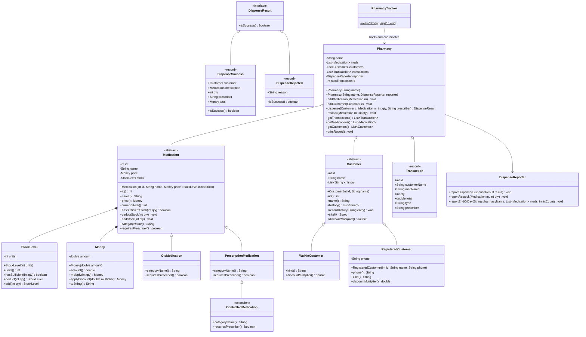
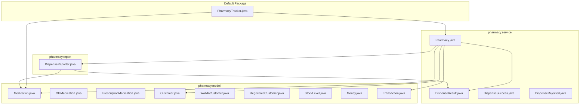
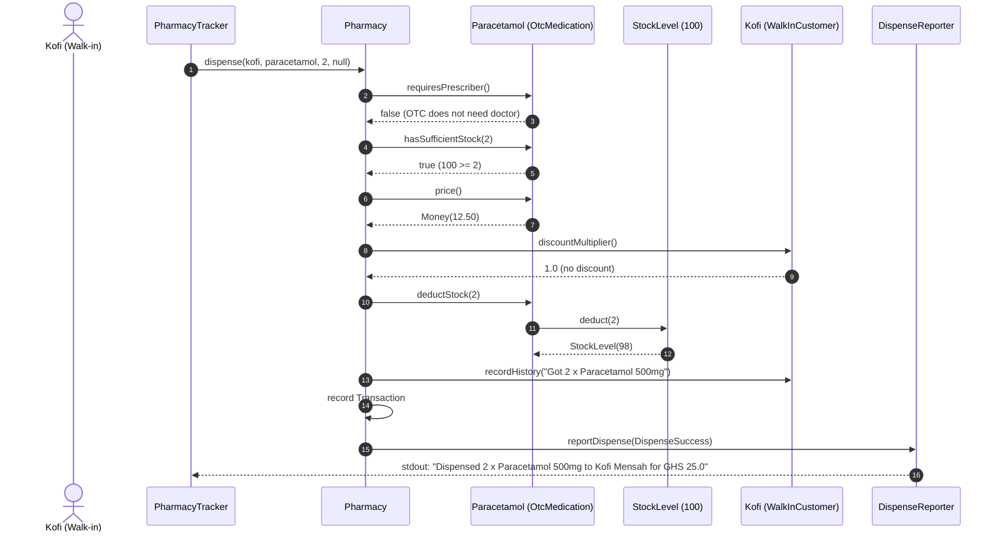
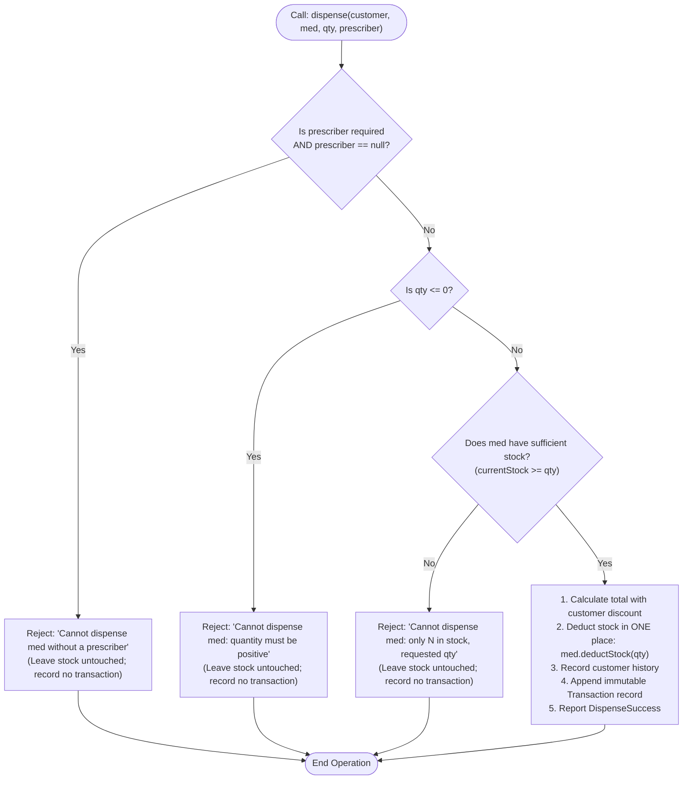
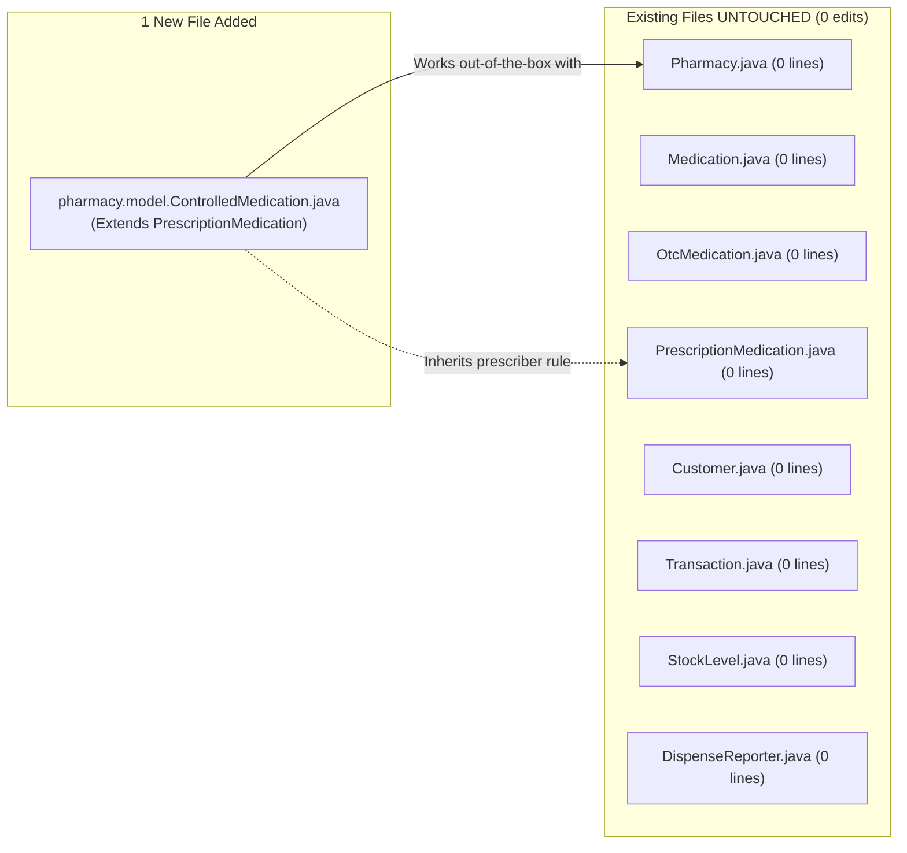
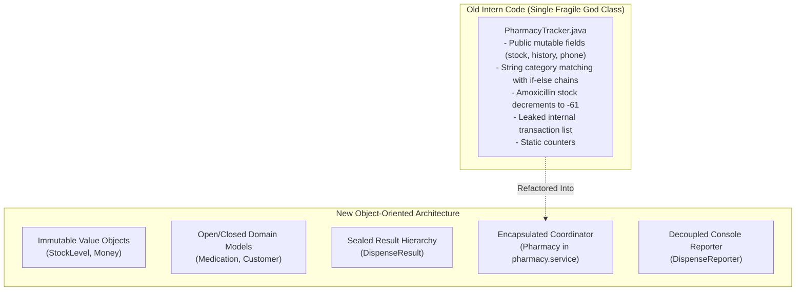

# System Architecture: Akosua's Pharmacy

This document explains the architecture of the rebuilt pharmacy management system using visual diagrams and plain-language descriptions.

---

## 1. Complete Class Diagram of the Final Design

This diagram represents the actual production and test classes in the system.



### Explanation:
- `StockLevel` and `Money` are immutable value objects ensuring safe arithmetic and output preservation.
- `Medication` is an open abstract class, allowing categories like `ControlledMedication` to plug in with zero changes to production code.
- `Customer` and `DispenseResult` are sealed hierarchies because customer discount tiers and operation outcomes represent strictly closed domain sets.
- `Pharmacy` acts as the aggregate root coordinator, returning only unmodifiable views.

---

## 2. Package Dependency Diagram



### Plain Explanation:
- `PharmacyTracker` stays in the root default package so terminal commands (`javac` and `mvn exec:java`) remain identical to the lab instructions.
- `pharmacy.service` depends on `pharmacy.model` and `pharmacy.report`, but `pharmacy.model` depends on nothing outside itself. There are no circular dependencies.

---

## 3. Sequence Diagram: Kofi Dispenses Paracetamol (OTC Path)

This trace illustrates what happens when Kofi (walk-in) buys 2 packets of Paracetamol at GHS 12.50.



---

## 4. Sequence Diagram: Prescription Dispensing with Rejections

This trace shows both happy and unhappy paths when dispensing prescription medication.

```mermaid
sequenceDiagram
    autonumber
    participant Client as Caller
    participant Pharm as Pharmacy
    participant Med as Amoxicillin 250mg
    participant Rep as DispenseReporter

    Note over Client,Pharm: Case 1: Missing Prescriber
    Client->>Pharm: dispense(kofi, amoxicillin, 1, null)
    Pharm->>Med: requiresPrescriber()
    Med-->>Pharm: true
    Pharm->>Rep: reportDispense(DispenseRejected: "without a prescriber")
    Note over Pharm: Return early; stock & ledger UNTOUCHED

    Note over Client,Pharm: Case 2: Negative Quantity
    Client->>Pharm: dispense(kofi, amoxicillin, -5, "Dr. Boateng")
    Pharm->>Rep: reportDispense(DispenseRejected: "quantity must be positive")
    Note over Pharm: Return early; stock & ledger UNTOUCHED

    Note over Client,Pharm: Case 3: Over-dispensing (Stock=39, Request=100)
    Client->>Pharm: dispense(kofi, amoxicillin, 100, "Dr. Boateng")
    Pharm->>Med: requiresPrescriber()
    Med-->>Pharm: true (valid doctor)
    Pharm->>Med: hasSufficientStock(100)
    Med-->>Pharm: false (only 39 in stock)
    Pharm->>Rep: reportDispense(DispenseRejected: "only 39 in stock, requested 100")
    Note over Pharm: Stock STAYS 39; NO history; NO transaction
```

---

## 5. Flowchart: The Three-Step Validation Order

The business requires validation checks to occur in a specific, deterministic order before any state mutation can take place.



---

## 6. "Adding CONTROLLED" Extensibility Diagram

When Akosua's pharmacy adds regulated controlled substances, here is exactly what changes:



---

## 7. Old Design vs. New Design Comparison


