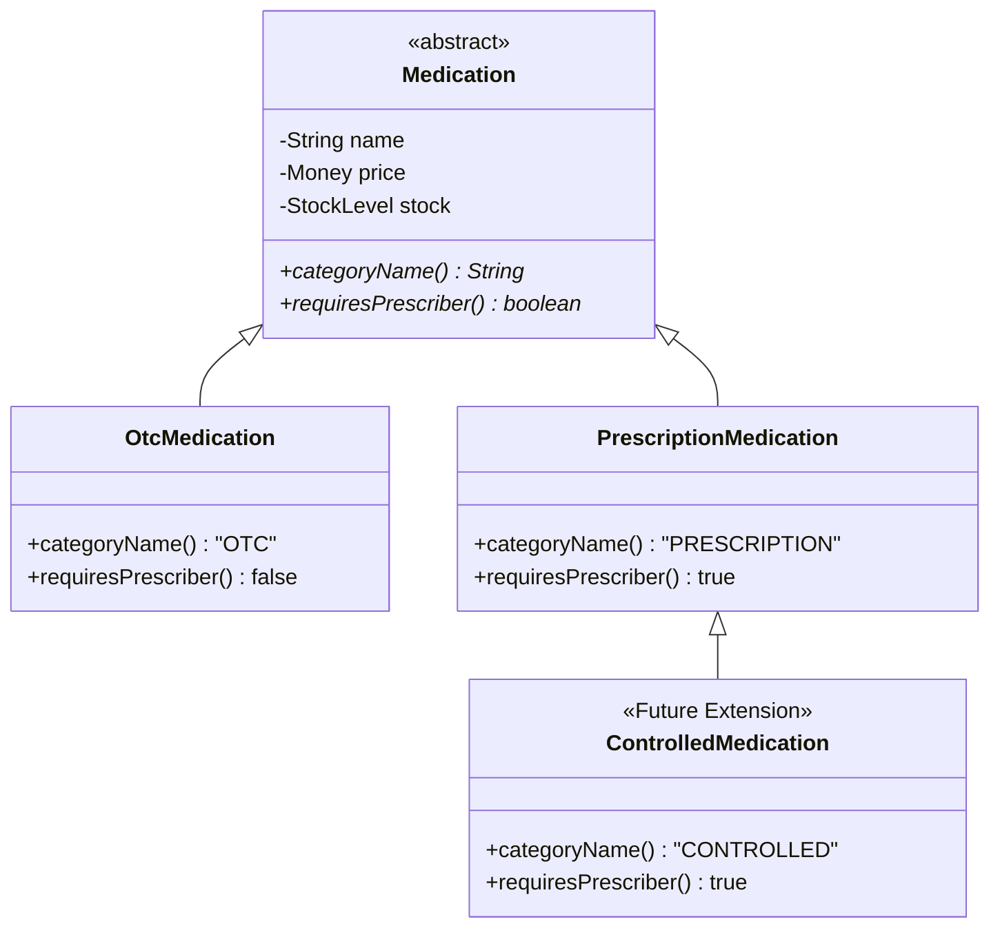

# ADR-001: Medication Hierarchy and Category Modeling

## Decision in Plain Words
> I replaced string-based drug categories ("OTC", "PRESCRIPTION") with an ordinary abstract class `Medication` and concrete subclasses `OtcMedication` and `PrescriptionMedication`. This allows future categories like `ControlledMedication` to be added in brand-new files with **zero edits** to existing code.

## Context
In the original single-file program, medication categories were represented as arbitrary string literals (`"OTC"` or `"PRESCRIPTION"`). The `Pharmacy.dispense()` method contained branching `if-else if` blocks that mixed pricing calculations, prescriber validation, stock deductions, and string formatting. Adding a new category like `CONTROLLED` forced modification of `Pharmacy.dispense()` and risked breaking existing logic.

## Options Considered
1. **Enum Category with Behavior**: An enum defining `OTC` and `PRESCRIPTION` with strategy methods. While type-safe, enums are closed at compile time; adding a new category requires editing the enum file itself.
2. **Sealed Abstract Class**: A sealed `Medication` permitting `OtcMedication` and `PrescriptionMedication`. While compile-time closed, adding `ControlledMedication` would require opening the `permits` list in `Medication.java`.
3. **Ordinary Abstract Class (Chosen)**: A standard non-sealed abstract class `Medication` extended by `OtcMedication` and `PrescriptionMedication`.

## Decision Diagram

## Before vs After Comparison
- **Before**: `if (m.category.equals("OTC")) { ... } else if (m.category.equals("PRESCRIPTION")) { ... }` inside `Pharmacy.dispense()`.
- **After**: `if (m.requiresPrescriber() && prescriber == null) ...` evaluated polymorphically without inspecting category strings.

## Accepted Trade-off
The Java compiler does not prevent external subclasses from being written, but runtime invariant checks in `Pharmacy` protect system integrity.
