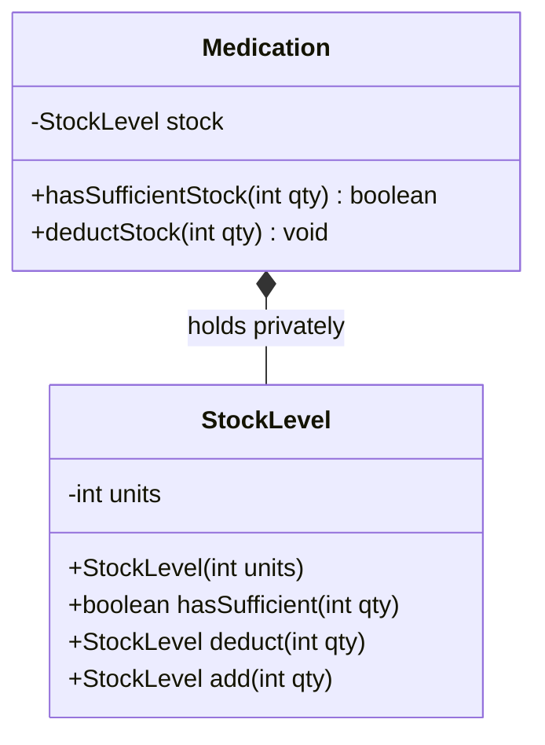

# ADR-002: Encapsulation of the Stock Invariant

## Decision in Plain Words
> I created an immutable value object called `StockLevel` that guarantees inventory cannot be negative (`units >= 0`). `Medication` holds this privately, making negative stock mathematically unrepresentable.

## Context
The most dangerous defect in the legacy codebase was an unvalidated, public `stock` field that allowed Amoxicillin inventory to fall to `-61` while issuing a sale. A pharmacy cannot dispense nonexistent physical medications.

## Options Considered
1. **Guarded Primitive Inside Medication**: Keep `stock` as a private `int` within `Medication` with guarded methods like `deductStock(int qty)`. While simple, the primitive `int` can still technically hold negative values if an internal method contains an arithmetic defect.
2. **Dedicated Immutable `StockLevel` Value Object (Chosen)**: An immutable value type `StockLevel` whose constructor strictly enforces `units >= 0`. Operations such as `deduct(int qty)` and `add(int qty)` return a new `StockLevel` instance or throw an `IllegalArgumentException` if the result would be negative.

## Decision Diagram

## Before vs After Comparison
- **Before**: `m.stock = m.stock - 100; // 39 - 100 = -61 in stock!`
- **After**: `stock.hasSufficient(100)` returns `false`; dispense is rejected and stock stays at `39`.

## Accepted Trade-off
Creates small, short-lived heap allocations for value objects when restocked or dispensed, which JDK 21's modern garbage collector handles with negligible overhead.
