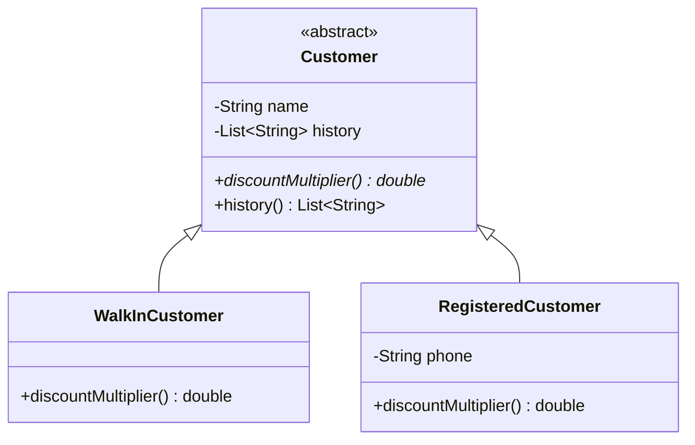

# ADR-003: Customer Hierarchy and Loyalty Discount Ownership

## Decision in Plain Words
> I made a sealed `Customer` hierarchy where each customer type owns its own discount multiplier (`1.0` for walk-ins, `0.95` for registered patients). `Pharmacy` simply asks the customer for its multiplier instead of using `if (c.kind.equals("REGISTERED"))`.

## Context
In the original code, customer types were tracked as raw strings (`"WALK_IN"` vs `"REGISTERED"`), and a 5% discount was hardcoded inside `Pharmacy.dispense()` using `if (c.kind.equals("REGISTERED")) total = total * 0.95;`. This violated Tell-Don't-Ask and duplicated logic across medication branches.

## Options Considered
1. **Customer Enum with Multiplier**: An enum property inside a single `Customer` class. This handles multipliers but fails to model structural differences (e.g., registered patients requiring phone numbers).
2. **Sealed Class Hierarchy (Chosen)**: A sealed abstract `Customer` class extended by `WalkInCustomer` and `RegisteredCustomer`.

## Decision Diagram

## Before vs After Comparison
- **Before**: `if (c.kind.equals("REGISTERED")) total = total * 0.95;` copy-pasted across multiple if/else branches.
- **After**: `total.applyDiscount(c.discountMultiplier())` invoked uniformly on the customer object.

## Accepted Trade-off
Adding a third customer tier (such as `SeniorCustomer` with a 10% discount) requires extending the sealed hierarchy with a new permitted class.
