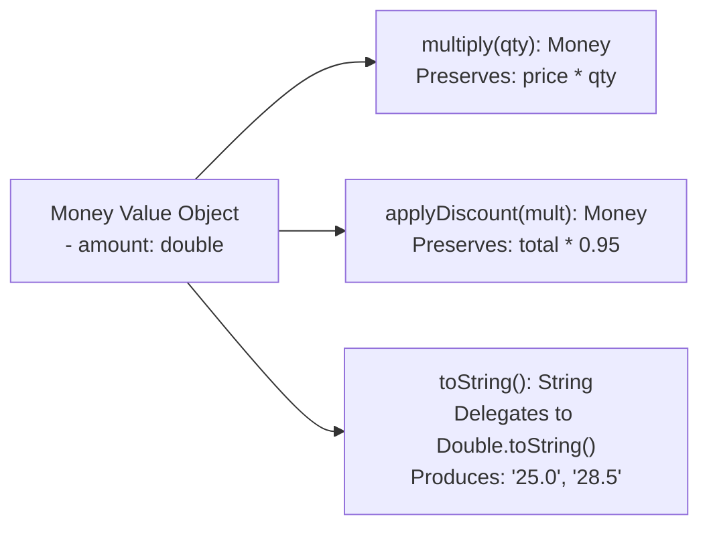

# ADR-004: Money Representation and Output Fidelity

## Decision in Plain Words
> I created an immutable `Money` value object that wraps a `double` internally. Its `toString()` method delegates to `Double.toString()` so that console outputs (`25.0`, `28.5`) match Akosua's original receipts byte for byte.

## Context
The legacy application used IEEE 754 binary floating-point `double` for prices and totals (`12.50`, `30.00`, `25.0`, `28.5`, `3000.0`). While binary floating-point accumulates rounding errors over long periods, the lab specification mandates strict output preservation against `baseline/original-output.txt`.

## Options Considered
1. **Raw `double`**: Continue using primitive `double` everywhere. While simple, it perpetuates primitive obsession and lacks domain semantics.
2. **`BigDecimal`**: The standard financial choice for commercial banking. However, `BigDecimal.toString()` formats numbers differently (e.g. `25.00` or `28.50`), which directly breaks the baseline output contract (`25.0`, `28.5`).
3. **Custom Immutable `Money` Value Type (Chosen)**: A lightweight domain value object wrapping a `double`, whose `toString()` delegates exactly to `Double.toString(amount)`.

## Decision Diagram

## Before vs After Comparison
- **Before**: `double total = m.price * qty; if (registered) total = total * 0.95; System.out.println("for GHS " + total);`
- **After**: `Money total = m.price().multiply(qty).applyDiscount(c.discountMultiplier());`

## Accepted Trade-off
I accepted the precision limits of binary `double` for this version to preserve exact output compatibility; a commercial migration to `BigDecimal` with integer minor units is documented as a future enhancement.
