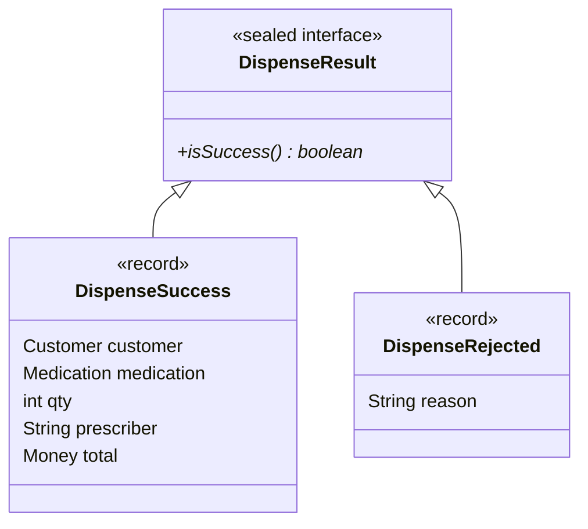

# ADR-005: Failure Handling and Domain Results

## Decision in Plain Words
> I introduced a sealed `DispenseResult` (`DispenseSuccess` or `DispenseRejected`) returned by `Pharmacy.dispense()`. The domain coordinator computes the outcome, while `DispenseReporter` prints the message, avoiding application crashes.

## Context
When a dispense or restock fails (e.g., missing prescriber, insufficient stock, negative quantity), the system must reject the operation cleanly without corrupting stock, customer history, or transaction records.

## Options Considered
1. **Exceptions (`InsufficientStockException`)**: Throwing checked or unchecked exceptions on business rejection. Handling normal business rejections via exceptions in a CLI batch workflow would disrupt the report flow or require cluttering `PharmacyTracker` with try-catch blocks.
2. **Sealed `DispenseResult` Hierarchy with Dedicated Reporter (Chosen)**: A sealed domain result type (`DispenseSuccess` vs `DispenseRejected`) paired with a `DispenseReporter` that prints console messages.

## Decision Diagram

## Before vs After Comparison
- **Before**: Rejection printed directly inside `Pharmacy` methods with early `return;`, while falling through on unrecognized categories.
- **After**: `Pharmacy.dispense()` returns an explicit `DispenseResult` instance; console formatting is handled by `DispenseReporter`.

## Accepted Trade-off
Requires callers to inspect `result.isSuccess()` if they wish to branch programmatically, but keeps the domain fully testable without throwing runtime exceptions.
