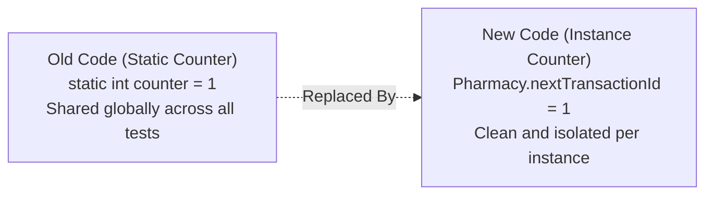

# ADR-006: Instance-Scoped ID Generation

## Decision in Plain Words
> I eliminated global static counters (`static int counter = 1`) and gave ID sequence ownership to each `Pharmacy` instance, ensuring that test runs and independent stores never pollute each other's ID sequences.

## Context
The starter classes used static counters (`static int counter = 1;` in `Medication`, `Customer`, and `Transaction`) that auto-incremented inside constructors. Static mutable state causes unpredictable IDs across unit tests, prevents running isolated test instances, and is not thread-safe.

## Options Considered
1. **Retain Static Counters**: Leaves mutable global state in memory.
2. **External UUID Strings**: Passing arbitrary UUID strings. This would break the integer ID representation (`1`, `2`, `3`) used in transactions and entity tracking.
3. **Pharmacy-Owned Instance Sequences (Chosen)**: `Pharmacy` maintains private instance counters (`nextTransactionId`) and assigns final IDs when transactions are created.

## Decision Diagram

## Before vs After Comparison
- **Before**: `class Transaction { static int counter = 1; public Transaction(...) { this.id = counter++; } }`
- **After**: `Pharmacy` manages `nextTransactionId++` locally; unit tests get clean, isolated IDs starting at 1.

## Accepted Trade-off
Entities created outside a `Pharmacy` instance must be assigned an ID or passed to the coordinator for indexing.
