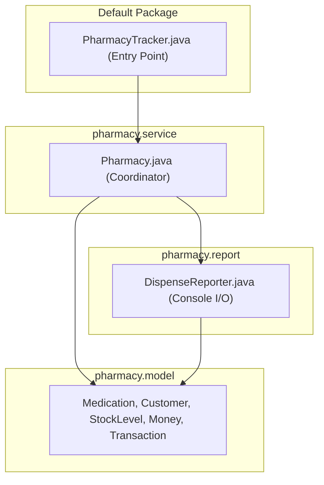

# ADR-007: Package Layout and Namespace Separation

## Decision in Plain Words
> I moved `Pharmacy` into `pharmacy.service`, models into `pharmacy.model`, and reporting into `pharmacy.report`, while keeping only `PharmacyTracker.java` in the default package so the standard `javac` and `mvn exec:java` run commands work seamlessly.

## Context
The starter codebase was a single file in the default package. While modularization is essential, the university lab and README instructions require that standard compilation and execution commands (`javac` and `mvn exec:java -Dexec.mainClass=PharmacyTracker`) continue to work seamlessly.

## Options Considered
1. **Flat Default Package**: Leaving all classes in the root default package. This creates namespace pollution and violates modular boundaries.
2. **Move Everything into Subpackages**: Moving `PharmacyTracker` into `com.amalitech.pharmacy` would break `mvn exec:java -Dexec.mainClass=PharmacyTracker` unless the POM or execution arguments were altered.
3. **Domain Packages with Thin Root Entry Point (Chosen)**: Place domain models in `pharmacy.model`, the aggregate coordinator in `pharmacy.service`, and reporting in `pharmacy.report`, leaving only `PharmacyTracker` in the default package.

## Decision Diagram

## Before vs After Comparison
- **Before**: All 5 classes stuffed into a single 156-line file in the default package.
- **After**: 13 focused classes and records organized cleanly into cohesive packages.

## Accepted Trade-off
Classes consumed across package boundaries by `PharmacyTracker` must declare `public` visibility.
