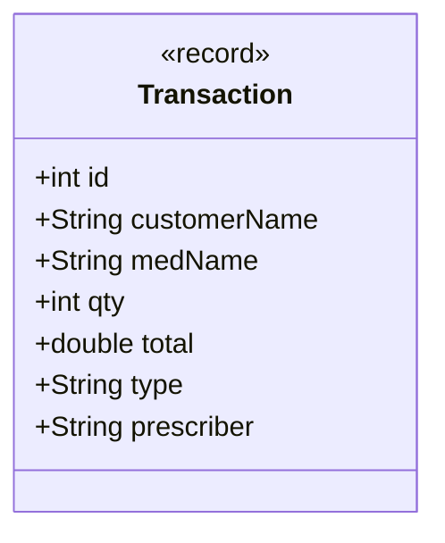

# ADR-008: Prescriber Tracking on Transactions

## Decision in Plain Words
> I made `Transaction` an immutable Java record with a `prescriber` field (null for OTC/restock, filled for prescriptions) so the ledger is ready for controlled substances without needing future schema migrations.

## Context
In the original program, `Transaction` recorded `customerName`, `medName`, `qty`, `total`, and `type`, but completely omitted `prescriber`. Consequently, audits could never determine which physician authorized a prescription dispense. Furthermore, adding the upcoming `CONTROLLED` category would force breaking schema changes onto `Transaction`.

## Options Considered
1. **Separate Subclasses of Transaction (`PrescriptionTransaction`)**: Adds class proliferation for what is fundamentally an immutable audit log record.
2. **Optional / Nullable Prescriber on `Transaction` Record (Chosen)**: Define `Transaction` as a Java record containing `String prescriber`.

## Decision Diagram

## Before vs After Comparison
- **Before**: `new Transaction(c.name, m.name, qty, total, "DISPENSE"); // Prescriber discarded!`
- **After**: `new Transaction(id, customer, med, qty, total, "DISPENSE", "Dr. Boateng");`

## Accepted Trade-off
`prescriber` is stored as `null` for OTC dispenses and supplier restocks, which is standard for nullable audit columns.
